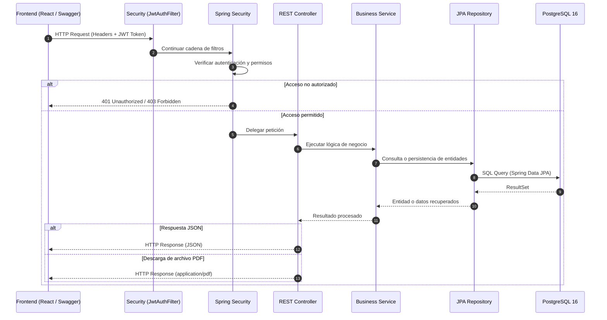

# 🏗️ Arquitectura del Sistema y Flujo de Datos

## 1. Arquitectura en Capas (Backend Spring Boot)

El sistema sigue una arquitectura REST multicapa desacoplada, donde cada responsabilidad está delimitada:

1. **Client / Presentation Layer (Frontend):** Aplicación React (Vite) que consume la API REST mediante solicitudes HTTP. Para las operaciones protegidas envía el encabezado `Authorization: Bearer <token>`.
2. **Security & Filter Layer:** Interceptor `JwtAuthFilter` que valida la firma y vigencia del token JWT cuando se proporciona. Spring Security aplica las reglas de autorización correspondientes según los endpoints y roles.
3. **Controller Layer (`@RestController`):** Expone los endpoints de la API, gestiona las peticiones HTTP y mapea las entradas y salidas mediante DTOs. También gestiona la recepción y descarga de archivos adjuntos.
4. **Service Layer (`@Service`):** Contiene la lógica de negocio, incluyendo el cálculo de vencimientos, las reglas de estado de contratos, el registro de auditoría, la gestión de archivos PDF y el hash de contraseñas con BCrypt.
5. **Data Access Layer (`@Repository`):** Interfaces que extienden de `JpaRepository` para la abstracción de consultas a la base de datos mediante Spring Data JPA. Incluye repositorios para contratos, clientes, usuarios, auditoría y archivos adjuntos.
6. **Database Layer:** Instancia de PostgreSQL 16 ejecutándose en un contenedor Docker, aislada del entorno local. Almacena las entidades del sistema y los archivos PDF adjuntos mediante columnas de tipo `BYTEA`.

---
## Módulos del Sistema

El sistema se compone de los siguientes módulos funcionales, todos desarrollados e integrados:

| Módulo | Descripción | Backend | Frontend | Estado |
| :--- | :--- | :--- | :--- | :---: |
| Autenticación y sesión | Login con JWT y protección de rutas. | AuthController, JwtService | Login, AuthContext | Implementado |
| Usuarios y roles | Alta, cambio de rol y baja de usuarios con control de acceso por rol (ADMIN / OPERATOR). | UserController | Users | Implementado |
| Clientes | Alta, edición y baja de clientes, con validación de DNI/CUIT/CUIL y teléfono. | ClientController | Clients | Implementado |
| Contratos | Alta, edición y baja de contratos con estado calculado automáticamente según las fechas. | ContractController | Contracts | Implementado |
| Vencimientos y dashboard | Indicadores, gráficos y recálculo programado diario de estados. | ContractStatusScheduler | Dashboard | Implementado |
| Auditoría | Historial de acciones sobre cada contrato. | ContractAuditLog | Historial en Contratos | Implementado |
| Adjuntos PDF | Carga, listado y descarga de PDF por contrato (máx. 10 MB). | ContractAttachmentService | ContractAttachments | Implementado |

Las tablas que respaldan estos módulos están descritas en el diccionario de datos (`data-dictionary.md`) y en el diagrama entidad-relación (`01-der-database.md`).

---

## 2. Gestión de números telefónicos

Los números telefónicos de los clientes se almacenan separados en dos campos:

- `phoneCountryCode`: código telefónico internacional, por ejemplo `+54`.
- `phoneNumber`: número telefónico sin el código de país.

En el frontend, los códigos de país disponibles se mantienen centralizados en `src/constants/countries.ts`, evitando que esta información quede acoplada al componente `ClientForm`.

Para el alcance actual del proyecto se contempla un conjunto acotado de países de uso frecuente. Esta decisión permite mantener una implementación simple y adecuada al alcance de la aplicación, dejando abierta la posibilidad de ampliar la lista posteriormente sin modificar la lógica del formulario.

La validación y normalización avanzada de números telefónicos mediante una librería especializada se considera una posible mejora futura.

---

## 3. Auditoría de Contratos

El sistema incorpora un mecanismo de auditoría para mantener la trazabilidad de las principales acciones realizadas sobre los contratos.

La auditoría se gestiona desde `ContractService`, donde se registra cada acción después de realizar la operación correspondiente sobre el contrato.

Las acciones auditadas son:

- `CREATED`: creación de un contrato.
- `UPDATED`: modificación de los datos de un contrato.
- `STATUS_CHANGED`: cambio de estado del contrato.
- `ATTACHMENT_ADDED`: incorporación de un archivo adjunto a un contrato.

Cada registro almacena:

- contrato asociado;
- acción realizada;
- usuario que ejecutó la acción;
- detalle de la operación;
- fecha y hora.

Cuando se incorpora un archivo adjunto, el detalle de auditoría registra su nombre original.

Los cambios de estado realizados automáticamente por el sistema se registran con `SYSTEM` como usuario ejecutor.

Los registros son persistidos mediante `ContractAuditLogRepository` en la tabla `contract_audit_log`.

El historial puede consultarse mediante:

`GET /api/contracts/{id}/audit`

---

## 4. Gestión de archivos adjuntos PDF

El sistema permite asociar múltiples archivos PDF a un mismo contrato.

La gestión se implementa mediante una capa de servicio específica, `ContractAttachmentService`, junto con su repositorio `ContractAttachmentRepository` y la entidad `ContractAttachment`.

### Almacenamiento

Los archivos se almacenan directamente en PostgreSQL, en la tabla `contract_attachments`, utilizando una columna de tipo `BYTEA`.

Cada registro contiene:

- identificador del adjunto;
- contrato asociado;
- nombre original del archivo;
- tamaño en bytes;
- contenido binario del PDF;
- usuario que realizó la carga;
- fecha y hora de carga.

### Validaciones

Antes de guardar un archivo, el backend verifica:

- que el archivo no esté vacío;
- que no supere los 10 MB;
- que presente la firma inicial `%PDF-`;
- que tenga un nombre válido de hasta 255 caracteres.

### Seguridad y acceso

Las operaciones de carga, listado y descarga requieren autenticación mediante JWT.

Además, el backend verifica que el archivo solicitado pertenezca al contrato indicado en la URL.

Los datos binarios no se incluyen en las respuestas JSON del listado de adjuntos. La descarga se realiza mediante un endpoint específico que devuelve el contenido con tipo de contenido `application/pdf`.

Al eliminar un contrato, sus archivos adjuntos se eliminan automáticamente mediante una clave foránea con `ON DELETE CASCADE`.
Si el archivo supera los 10 MB, la API responde `413 Payload Too Large`, tanto cuando lo detecta Spring (límite multipart) como cuando lo detecta el servicio. Las demás validaciones responden `400 Bad Request`.
### Endpoints asociados

- `POST /api/contracts/{id}/attachments`: subir un PDF.
- `GET /api/contracts/{id}/attachments`: listar los adjuntos de un contrato.
- `GET /api/contracts/{id}/attachments/{attachmentId}`: descargar un adjunto.

---

## 5. Diagrama de Flujo Petición REST (Mermaid Syntax)

El siguiente diagrama representa el flujo general de una petición a la API, incluyendo la autenticación, autorización y acceso a la base de datos.

## 6. Arranque del sistema

Al iniciar la aplicación se ejecutan dos procesos:

- Usuario administrador inicial: si no existe ningún usuario ADMIN y están definidas las variables BOOTSTRAP_ADMIN_USERNAME y BOOTSTRAP_ADMIN_PASSWORD, se crea uno. Si ya existe un ADMIN, no se hace nada.
- Actualización de estados: se recalculan los estados de los contratos, además de la tarea programada diaria de la 01:00.

## 7. Manejo de errores

`GlobalExceptionHandler` (`@RestControllerAdvice`) centraliza las respuestas de error. El cuerpo es siempre un objeto JSON: `{"error": "mensaje"}` en general, o `{"campo": "mensaje"}` cuando el error pertenece a un campo del formulario.

| Excepción | Estado HTTP | Cuerpo |
| :--- | :---: | :--- |
| `MethodArgumentNotValidException` | 400 | `{"campo": "mensaje"}` por cada campo inválido |
| `InvalidTaxIdException` | 400 | `{"taxId": "mensaje"}` |
| `IllegalArgumentException` | 400 | `{"error": "mensaje"}` |
| `InvalidCredentialsException` | 401 | `{"error": "mensaje"}` |
| `ResourceNotFoundException` | 404 | `{"error": "mensaje"}` |
| `IllegalStateException` | 409 | `{"error": "mensaje"}` (reglas de negocio, como no eliminar el propio usuario o un cliente con contratos) |
| `DuplicateResourceException` | 409 | `{"error": "mensaje"}` (por ejemplo, username repetido) |
| `FileTooLargeException` y `MaxUploadSizeExceededException` | 413 | `{"error": "mensaje"}` |

Cada error de validación de DNI/CUIT/CUIL usa la clave `taxId` para que el frontend lo muestre debajo del campo correspondiente.