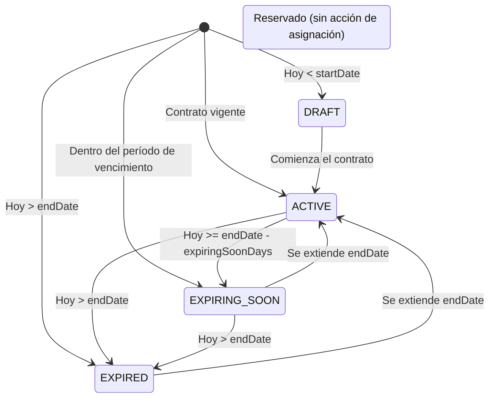

# 🔄 Máquina de Estados del Contrato (`ContractStatus`) y Proceso de Actualización

El estado de cada contrato se determina automáticamente a partir de sus fechas
de inicio y finalización, utilizando la fecha actual (`LocalDate.now()`) y la
propiedad configurable `contract.expiring-soon-days`.

El cálculo del estado se realiza al crear o modificar un contrato. Además, el sistema recalcula periódicamente los estados de los contratos en `DRAFT`, `ACTIVE` o `EXPIRING_SOON` (ver sección 4).

## 1. Estados del Contrato

Los estados disponibles son:

* `DRAFT`: el contrato todavía no comenzó.
* `ACTIVE`: el contrato se encuentra vigente y no está dentro del período de
  próximo vencimiento.
* `EXPIRING_SOON`: el contrato se encuentra vigente y dentro del período
  configurado como próximo a vencer.
* `EXPIRED`: la fecha de finalización ya fue superada.
* `UNDER_RENEWAL`: estado reservado para representar un proceso de renovación. No forma parte del cálculo automático y, en la versión actual, no existe una acción en la interfaz ni en la API para asignarlo; una edición del contrato recalcula el estado a partir de las fechas.

---

## 2. Reglas de Cálculo de Estado

El backend determina el estado siguiendo las siguientes reglas:

1. Si la fecha actual es anterior a `startDate`, el contrato queda en
   `DRAFT`.
2. Si la fecha actual es posterior a `endDate`, el contrato queda en
   `EXPIRED`.
3. Si la fecha actual se encuentra dentro del período definido por
   `expiringSoonDays` antes de `endDate`, el contrato queda en
   `EXPIRING_SOON`.
4. En cualquier otro caso, el contrato queda en `ACTIVE`.

El valor de `status` no es enviado por el frontend al crear o modificar un
contrato. El backend lo calcula automáticamente a partir de las fechas.

---

## 3. Máquina de Estados

---

## 4. Actualización Automática de Estados

El sistema recalcula los estados de los contratos en tres momentos:

* Todos los días a la 01:00, mediante una tarea programada.
* Cada vez que se inicia la aplicación, para corregir los cambios de estado ocurridos mientras estuvo apagada.
* A demanda, mediante `POST /api/contracts/update-statuses`.

El proceso consulta los contratos en `DRAFT`, `ACTIVE` o `EXPIRING_SOON` y calcula nuevamente su estado con las fechas actuales. Los contratos en `EXPIRED` y `UNDER_RENEWAL` no se procesan.

Si el estado calculado difiere del almacenado, el contrato se actualiza y se registra en la auditoría una entrada `STATUS_CHANGED` con `SYSTEM` como usuario ejecutor.

Además, cualquier modificación de las fechas de un contrato recalcula su estado desde cualquier estado de origen. Por ejemplo, extender la `endDate` de un contrato vencido lo devuelve a `ACTIVE` o `EXPIRING_SOON`.

---

## 5. Auditoría de Cambios de Estado

Los cambios de estado realizados como consecuencia de una actualización de
contrato también quedan registrados en la auditoría.

Por ejemplo:

`ACTIVE -> EXPIRING_SOON`

genera un registro:

* **Action:** `STATUS_CHANGED`
* **Performed by:** usuario que realizó la modificación o `SYSTEM` si el cambio
  fue automático.
* **Detail:** `ACTIVE -> EXPIRING_SOON`
* **Created at:** fecha y hora del cambio.

Esto permite mantener trazabilidad sobre la evolución del estado de cada
contrato.