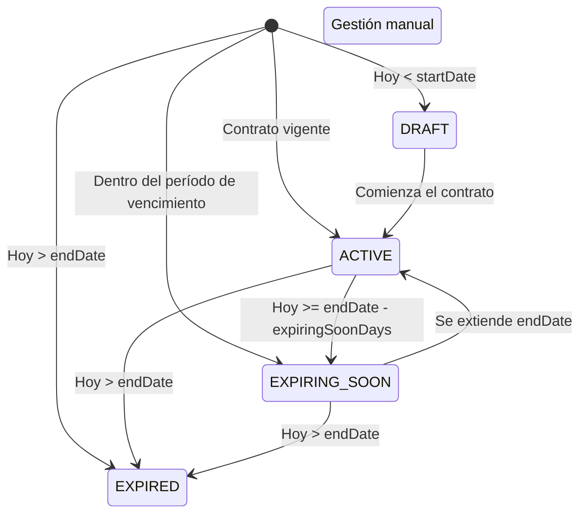

# 🔄 Máquina de Estados del Contrato (`ContractStatus`) y Proceso de Actualización

El estado de cada contrato se determina automáticamente a partir de sus fechas
de inicio y finalización, utilizando la fecha actual (`LocalDate.now()`) y la
propiedad configurable `contract.expiring-soon-days`.

El cálculo del estado se realiza al crear o modificar un contrato. Además, el
sistema dispone de un proceso de actualización que permite recalcular los
estados de los contratos que se encuentran actualmente en `ACTIVE` o
`EXPIRING_SOON`.

## 1. Estados del Contrato

Los estados disponibles son:

* `DRAFT`: el contrato todavía no comenzó.
* `ACTIVE`: el contrato se encuentra vigente y no está dentro del período de
  próximo vencimiento.
* `EXPIRING_SOON`: el contrato se encuentra vigente y dentro del período
  configurado como próximo a vencer.
* `EXPIRED`: la fecha de finalización ya fue superada.
* `UNDER_RENEWAL`: estado disponible para gestión manual relacionado con un
  proceso de renovación. No forma parte del cálculo automático.

---

## 2. Reglas de Cálculo de Estado

El backend determina el estado siguiendo las siguientes reglas:

1. Si la fecha actual es anterior a `startDate`, el contrato queda en
   `DRAFT`.
2. Si la fecha actual es posterior a `endDate`, el contrato queda en
   `EXPIRED`.
3. Si la fecha actual se encuentra dentro del período definido por
   `expiringSoonDays` antes de `endDate`, el contrato queda en
   `EXPIRING_SOON`.
4. En cualquier otro caso, el contrato queda en `ACTIVE`.

El valor de `status` no es enviado por el frontend al crear o modificar un
contrato. El backend lo calcula automáticamente a partir de las fechas.

---

## 3. Máquina de Estados



---

## 4. Actualización Automática de Estados

El endpoint:

`POST /api/contracts/update-statuses`

permite recalcular los estados de los contratos administrados por el sistema.

El proceso consulta los contratos que actualmente se encuentran en:

* `ACTIVE`
* `EXPIRING_SOON`

Para cada contrato se vuelve a calcular el estado utilizando las fechas
actuales.

Si el estado calculado es diferente al estado almacenado, el contrato se
actualiza y se registra una entrada en el historial de auditoría con la acción
`STATUS_CHANGED`.

Cuando el cambio es realizado por este proceso automático, el usuario
ejecutor de la auditoría se registra como `SYSTEM`.

---

## 5. Auditoría de Cambios de Estado

Los cambios de estado realizados como consecuencia de una actualización de
contrato también quedan registrados en la auditoría.

Por ejemplo:

`ACTIVE -> EXPIRING_SOON`

genera un registro:

* **Action:** `STATUS_CHANGED`
* **Performed by:** usuario que realizó la modificación o `SYSTEM` si el cambio
  fue automático.
* **Detail:** `ACTIVE -> EXPIRING_SOON`
* **Created at:** fecha y hora del cambio.

Esto permite mantener trazabilidad sobre la evolución del estado de cada
contrato.


```mermaid
stateDiagram-v2
    [*] --> DRAFT: Hoy < startDate
    [*] --> ACTIVE: Contrato vigente
    [*] --> EXPIRING_SOON: Próximo a vencer
    [*] --> EXPIRED: Hoy > endDate

    DRAFT --> ACTIVE: Comienza el contrato
    ACTIVE --> EXPIRING_SOON: Hoy >= endDate - expiringSoonDays
    ACTIVE --> EXPIRED: Hoy > endDate
    EXPIRING_SOON --> EXPIRED: Hoy > endDate
    EXPIRING_SOON --> ACTIVE: Extensión de endDate

    UNDER_RENEWAL: Estado manual