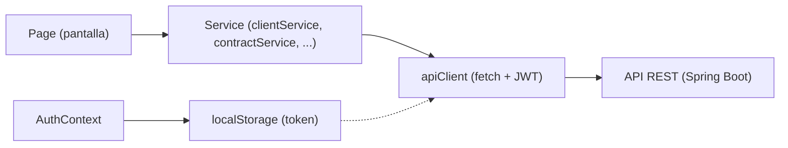

# 🖥️ Arquitectura del Frontend

## 1. Visión general

El frontend es una aplicación de página única (SPA) desarrollada con React, Vite y TypeScript. Consume la API REST del backend mediante `fetch`, utiliza React Router para la navegación y CSS Modules para los estilos.

| Aspecto | Tecnología |
| :--- | :--- |
| Lenguaje | TypeScript |
| Interfaz | React |
| Herramienta de desarrollo y build | Vite |
| Navegación | React Router |
| Estilos | CSS Modules y variables CSS globales |
| Comunicación con la API | `fetch`, centralizado en `apiClient` |
| Estado global | React Context (sesión y tema) |

---

## 2. Estructura del proyecto

```text
frontend/src/
├── components/
│   ├── auth/            — ProtectedRoute (protección de rutas)
│   ├── layout/          — SidebarLayout (menú lateral y contenedor)
│   └── ConfirmModal/    — modal de confirmación reutilizable
├── constants/           — countries.ts (códigos telefónicos de país)
├── contexts/            — AuthContext (sesión) y ThemeContext (tema)
├── hooks/               — useSortableData (ordenamiento de tablas)
├── pages/               — una carpeta por pantalla
│   ├── Login/
│   ├── Dashboard/       — Dashboard, ExpirationChart y StatusChart
│   ├── Clients/
│   ├── Contracts/
│   └── Users/
├── routes/              — AppRoutes (definición de rutas)
├── services/            — clientes de la API por recurso
├── styles/              — shared.module.css (clases compartidas)
├── types/               — tipos TypeScript del dominio
├── utils/               — formatters (moneda, fechas, estados)
├── App.tsx              — providers y router
├── main.tsx             — punto de entrada
└── index.css            — variables de diseño y estilos globales
```

Cada pantalla vive en su propia carpeta, con su componente, su módulo CSS y un `index.ts` que reexporta el componente. Los formularios y modales específicos de una pantalla (por ejemplo `ClientForm`, `ContractForm` o `ContractAttachments`) se ubican junto a ella.

---

## 3. Capas y flujo de datos



- **Pages:** manejan el estado de la pantalla (carga, error, datos, formularios abiertos) y llaman a los servicios.
- **Services:** conocen los endpoints y los tipos de cada recurso; las pantallas no construyen URLs.
- **apiClient:** concentra la URL base, el envío del token y el manejo de errores.
- **Contexts:** comparten la sesión y el tema con toda la aplicación sin pasar propiedades por cada nivel.

---

## 4. Autenticación y sesión

1. El usuario ingresa sus credenciales en la pantalla de Login, que invoca `POST /api/auth/login`.
2. El token JWT recibido se guarda en `localStorage` y `AuthContext` actualiza la sesión.
3. `apiClient` agrega el encabezado `Authorization: Bearer <token>` a cada solicitud.
4. `ProtectedRoute` redirige a `/login` cuando no hay sesión.
5. Al cerrar sesión se elimina el token y se vuelve a la pantalla de Login.

`AuthContext` expone `isAuthenticated`, `user` (nombre de usuario y rol), `login` y `logout`.

La interfaz adapta lo que muestra según el rol: la opción de menú Usuarios y los botones de eliminar solo se muestran a `ADMIN`. Esto mejora la experiencia, pero la autorización real la aplica el backend, que responde acceso denegado a cualquier operación no permitida.

---

## 5. Navegación

| Ruta | Pantalla | Acceso |
| :--- | :--- | :--- |
| `/login` | Inicio de sesión | Pública |
| `/dashboard` | Panel de control | Usuario autenticado |
| `/contracts` | Contratos | Usuario autenticado |
| `/clients` | Clientes | Usuario autenticado |
| `/users` | Administración de usuarios | Usuario autenticado; el menú solo se muestra a `ADMIN` |

Cualquier ruta desconocida redirige a `/dashboard`. La definición de rutas está en `routes/AppRoutes.tsx`; `App.tsx` solo monta los providers y el router.

---

## 6. Pantallas

### 6.1. Login
Formulario de usuario y contraseña. Muestra el mensaje de error devuelto por la API ante credenciales inválidas y, si el ingreso es correcto, redirige al panel.

### 6.2. Dashboard
Consume `GET /api/contracts/dashboard` y `GET /api/contracts`. Muestra:

- Tarjetas con los contratos activos, los próximos a vencer y el monto total comprometido.
- Gráfico de barras (`ExpirationChart`) con la cantidad de contratos que vencen en cada uno de los próximos meses.
- Gráfico de dona (`StatusChart`) con la distribución de los contratos por estado (borrador, activo, próximo a vencer, vencido y en renovación). Muestra el total de contratos en el centro y una leyenda con la cantidad de cada estado.
- Tabla de contratos con el estado de cada uno mediante un indicador de color.

Ambos gráficos se dibujan con SVG, sin librerías externas, y usan las variables de diseño globales, por lo que se adaptan al modo claro y oscuro. En pantallas angostas la dona y su leyenda se apilan verticalmente.

Contempla estados de carga y de error.

### 6.3. Clientes
- Listado con columnas ordenables.
- Alta y edición con un único formulario reutilizable (`ClientForm`).
- Teléfono con selector de código de país.
- Validación del DNI/CUIT/CUIL en el backend, con el mensaje de error mostrado debajo del campo correspondiente.
- Eliminación con modal de confirmación, solo para `ADMIN`. Si el cliente tiene contratos asociados, la API lo rechaza y se muestra el motivo.

### 6.4. Contratos
- Listado con columnas ordenables y estados traducidos con indicador de color.
- Alta y edición mediante `ContractForm`, seleccionando el cliente de la lista de clientes.
- El estado no se envía desde el frontend: lo calcula el backend a partir de las fechas.
- Eliminación con confirmación, solo para `ADMIN`.
- Historial de auditoría de cada contrato.
- Adjuntos PDF (ver 6.6).

### 6.5. Usuarios (solo `ADMIN`)
- Listado ordenable de usuarios.
- Alta de usuarios con rol.
- Cambio de rol mediante un selector por fila.
- Eliminación con confirmación.
- Un administrador no puede eliminar su propio usuario ni cambiar su propio rol: la interfaz deshabilita estas acciones y el backend valida la restricción.

### 6.6. Adjuntos PDF
Ventana modal asociada a un contrato que permite listar, subir y descargar sus archivos PDF.

- Antes de enviar, valida que el archivo sea PDF y que no supere los 10 MB; el backend repite estas validaciones y verifica la firma `%PDF-`.
- La subida usa `multipart/form-data`: el navegador define el `Content-Type`, por lo que esta operación usa `fetch` directamente en lugar de `apiClient`.
- La descarga solicita el archivo con el token, lo recibe como `blob` y dispara la descarga en el navegador. No se usa un enlace directo porque este no enviaría el encabezado de autenticación.

---

## 7. Comunicación con la API

`apiClient` es el único punto de acceso HTTP para las operaciones JSON:

- La URL base se toma de la variable de entorno `VITE_API_URL`.
- Agrega el token almacenado en cada solicitud.
- Si la respuesta no es exitosa, lanza un `Error` con el mensaje devuelto por el backend (campo `error` o primer mensaje de validación).
- Cuando el backend informa errores por campo, los conserva en `fieldErrors` para que los formularios los muestren junto al input.
- Interpreta las respuestas `204 No Content` sin cuerpo.

Los servicios (`authService`, `clientService`, `contractService`, `dashboardService`, `userService`, `contractAttachmentService`) encapsulan cada recurso y exponen funciones tipadas.

---

## 8. Estilos y diseño

- **CSS Modules:** cada componente tiene su hoja de estilos con ámbito local, lo que evita colisiones de nombres. Las clases comunes (contenedor principal, barra superior, tarjetas, botones, encabezados ordenables) están en `styles/shared.module.css`.
- **Variables de diseño:** colores, tipografía, radios, sombras y transiciones se definen como variables CSS en `index.css`. No hay colores ni valores de diseño escritos directamente en los componentes.
- **Modo claro y oscuro:** `ThemeContext` alterna la clase `dark` sobre el documento y guarda la preferencia en `localStorage`. El modo oscuro redefine las variables, incluidos los colores de los indicadores de estado.
- **Responsive:** el menú lateral se apila en la parte superior en pantallas angostas y las tablas se transforman en tarjetas, con un punto de corte que depende de la cantidad de columnas. Se verificó el funcionamiento hasta 320 px de ancho.

---

## 9. Componentes y utilidades reutilizables

| Elemento | Función |
| :--- | :--- |
| `ConfirmModal` | Modal de confirmación para acciones destructivas, con estado de carga. |
| `ClientForm` | Alta y edición de clientes con un único componente. |
| `useSortableData` | Hook genérico para ordenar tablas por columna, con indicador de dirección. |
| `formatters` | Formato de moneda (ARS), fechas, etiquetas de estado y clases de color. |
| `constants/countries` | Lista de códigos telefónicos, separada del formulario. |

---

## 10. Configuración y ejecución

La única variable de entorno es `VITE_API_URL`, definida en `frontend/.env` (se versiona un `.env.example` como plantilla).

```bash
npm install     # instalar dependencias
npm run dev     # servidor de desarrollo en http://localhost:5173
npm run build   # compilación de producción
npm run lint    # análisis estático con ESLint
```

El backend debe estar en ejecución y permitir el origen del frontend (variable `FRONTEND_URL`) para evitar bloqueos de CORS.

---

## 11. Decisiones de diseño

- **TypeScript:** los tipos del dominio reflejan los DTOs del backend y permiten detectar inconsistencias al compilar.
- **CSS Modules con variables globales:** aíslan los estilos por componente y centralizan el diseño, lo que hizo posible el modo oscuro sin duplicar estilos.
- **Capa de servicios:** las pantallas no conocen URLs ni detalles HTTP, por lo que un cambio en la API se corrige en un solo lugar.
- **Un formulario para alta y edición:** evita duplicar lógica y validaciones.
- **El estado del contrato lo calcula el backend:** el frontend nunca lo envía, así que no puede quedar inconsistente con las fechas.
- **Errores por campo:** el backend indica qué campo falló y el formulario lo muestra debajo del input correspondiente.
- **Tipos junto al componente:** si un tipo lo usa un solo componente, permanece en su archivo; si empieza a reutilizarse, se extrae a `types/`.

---

## 12. Limitaciones y mejoras futuras

- El token JWT se guarda en `localStorage`. Es simple, pero queda expuesto ante ataques XSS; una alternativa es una cookie `httpOnly`.
- El token dura 24 horas y no hay renovación automática: al vencer, el usuario debe volver a iniciar sesión.
- No hay pruebas automatizadas del frontend.
- La lista de códigos de país es acotada y no hay validación avanzada de teléfonos.
- La visibilidad por rol en la interfaz es solo de experiencia de uso; la seguridad depende del backend.